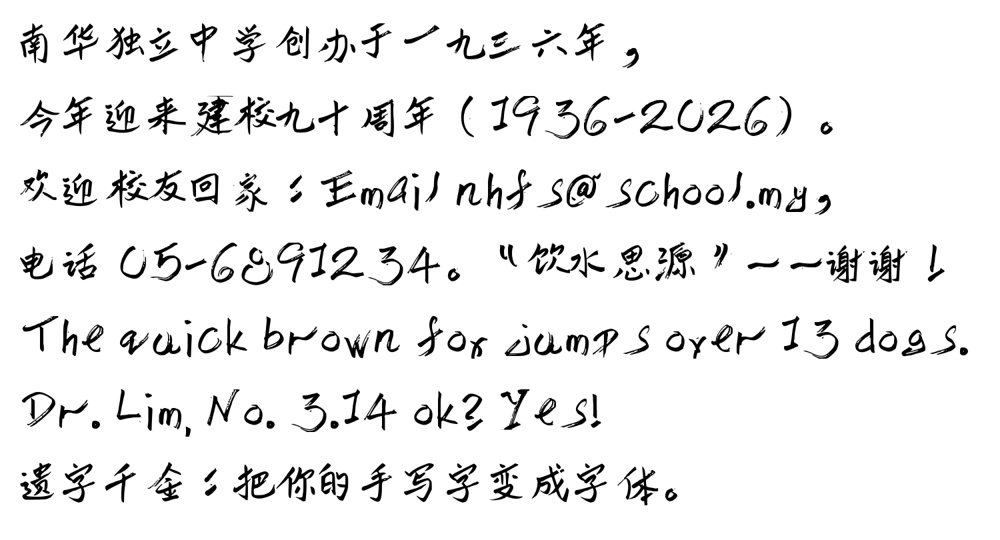
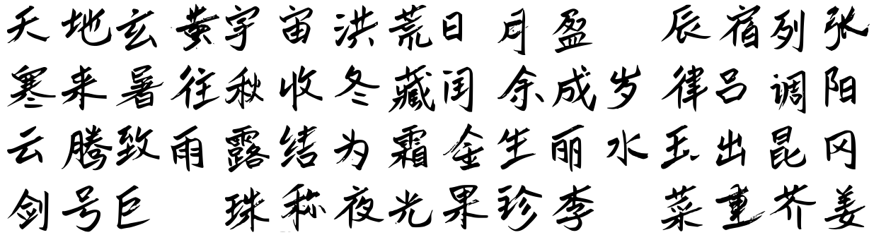

# 遗字千金 yz1000

**把一个人的手写字，留成一套能打字的字体。**



上图每个字都是用键盘打出来的。字体是项目发起人林子策的笔迹：他亲手写了两百多个字，其余三千多个常用字由 AI 照他的笔性补齐。

---

## 这是什么

一字千金，说的是字值钱。遗字千金，说的是**留下来的字**值钱。

每个人的笔迹都只属于他自己。这个项目做的事很简单：

1. 在两页 A4 字帖上写 100 个字；
2. 用手机拍下来；
3. 得到一个 `.ttf` 字体文件。装进电脑，就能用这个人的字打字、排版、印刷。

整条管道离线、免费、不用注册任何平台。

## 你会得到什么

| | 只用真迹 | 真迹＋AI 补字 |
|---|---|---|
| 要写多少字 | 写多少得多少（100～3500） | 50～100 字 |
| 字体里有几个字 | 等于你写的字数 | 3500 个常用字全覆盖 |
| 每个字是不是本人写的 | 是，1:1 描摹 | 写过的是；其余由模型按你的笔性生成 |
| 需要什么 | 打印机、黑笔、手机、Python | 另加 Kaggle 免费 GPU |

> ⚠️ 「真迹＋AI 补字」这一段目前依赖作者私有的 Kaggle 数据集和联合微调权重，外部暂时无法照着跑通。脚本已在 `kaggle/` 公开，供参考。「只用真迹」那一段完全自足，下面的步骤就是它。

## 三步做出你的字体

**准备**：Python 3，加几个套件：

```
python -m pip install fonttools potracer opencv-python pillow numpy
```

**① 打印字帖并书写**

打印 `template-core/C1.pdf`（100 个汉字）和 `C2.pdf`（英文字母、数字、标点）。A4，彩色或黑白都可以。

- 用黑色签字笔或原子笔，笔幅 0.7–1.0 mm。不要用铅笔，也不要用浅色笔。
- 大小、歪斜照你平时的样子写，不必工整。这些差异正是字体像你的原因。
- 写错、跳过几格都没关系，管道会自动排除空格，不会错位。

**② 拍照**

手机正面拍，每页一张，存成 `scans/C1.jpg`、`scans/C2.jpg`。只有三个要求：

- 四个角的黑色方块全部入镜；
- 纸摊平；
- 光线均匀。

用扫描 App 的话，请选「原图／无滤镜」。增强模式会把红色格线压黑，管道就去不掉格线。

**③ 出字体**

```
python tools/build_font.py --manifest template-core/manifest.json --sheet C1=scans/C1.jpg --sheet C2=scans/C2.jpg --out build/MyHand.ttf --family "My Hand"
```

跑完会得到 `build/MyHand.ttf` 和一张校对图 `build/MyHand_proof.png`。**先打开校对图逐字看一遍**，确认每个字都在、都对，再右键 `.ttf` 安装。

- 这样出来的英文字母与数字是全角宽度。要恢复正常的比例宽度，用 `tools/merge_latin.py`。
- 想要更多字，用 `tools/make_template.py` 出 1000 字或 3500 字的字帖。每张 120 格，可以分批写，字体随写随增。
- 两个命令的完整参数，见 [docs/技术笔记.md](docs/技术笔记.md)。

## 我们发现的事：50～100 个字就够了

AI 补字要先用本人真迹微调模型。我们做了对照实验，答案比预想的少：

- **写 50 个字，生成的字已带出本人笔性**：粗重笔画、飞白、斜势、个人写法都在。
- **字写得越多，生成的字反而越整齐，越不像手写。** 量字与字之间倾斜程度的离散度（越大越像手写）：真迹 0.182，写 50 字 0.161，写 100 字 0.156，写 212 字 0.142，完全不训练 0.130。模型学到的是各种写法的平均值。
- **飞白不是脏数据。** 清理训练字时，只能去掉离笔画远的孤立杂点。贴着笔画的碎块是飞白，删了字就变整齐。

书写者本人看过对照表后，定下 **50～100 字、训练 1000 步**。「核心 100 字」字帖就是这样来的：这 100 个字按部件和结构位置挑选，第一个字是「永」（永字八法）。

> 这是倾向，不是定论：每档只训练一次，留出 40 字作考题。实验设计与数据见 [docs/技术笔记.md](docs/技术笔记.md)。

## 示范字体：林子策手写体

`fonts/LinZiCe/LinZiCe-Hand.ttf`，可直接下载安装。



- 263 个汉字是真迹，其余 3240 字由 FontDiffuser 补齐，3500 个一级常用字全覆盖；另有 96 个手写英数标点，共 3600 个字。
- 已知不足：生成字的笔画比真迹粗约 13%；一级字表以外的字（如「昃」「阙」）没有收录，会由系统字体顶替。
- 2026-10-20 修正：逐字核对后，重新生成并替换了 146 个写错或难以辨认的 AI 补字（例如「一」原来像一撇、「于」像「千」、「牵」缺了「冖」）。下载过旧版的请重新下载。
- 授权：**SIL Open Font License 1.1**，可免费使用、嵌入、再发布，见 `fonts/LinZiCe/OFL.txt`。

## 关于隐私

一套手写字体，就是一个能用某人笔迹写任何内容的工具。所以：

- 本仓库**只公开发起人本人**的字体。其他参与者的真迹照片和字体一律不公开。
- 帮别人做字体时，字体文件只交给笔迹主人本人，由他决定给谁用。

## 目录

| 位置 | 内容 |
|---|---|
| `template-core/` | 核心 100 字两页字帖（推荐从这里开始） |
| `template*/` | 其他字数的空白字帖 |
| `tools/` | 出字帖、出字体、合并英数标点等脚本 |
| `kaggle/` | AI 补字的微调与生成脚本（不含数据和权重） |
| `fonts/LinZiCe/` | 示范字体 |
| `docs/技术笔记.md` | 完整技术文档：验收机制、调参旋钮、踩过的坑、S-Pen 触屏采集、实验细节 |

## 授权

- 代码：MIT，见 `LICENSE`。
- 字体：SIL OFL 1.1，见 `fonts/LinZiCe/OFL.txt`。

由马来西亚霹雳州曼绒南华独立中学教师林子策发起。
